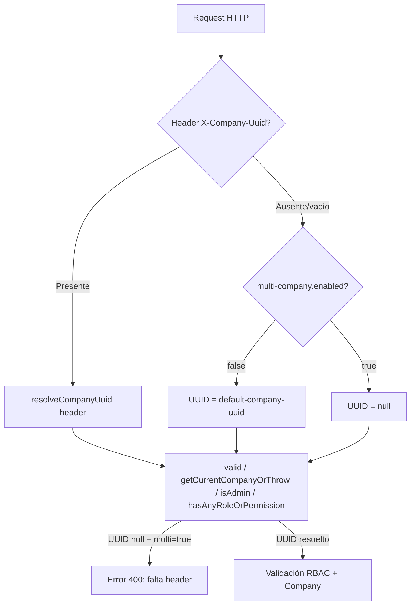

# Core 1.1.3

## Resumen

Esta versión consolida el **modo multi-company / mono-company** del framework: dos propiedades de configuración controlan si el backend exige el header `X-Company-Uuid` o inyecta automáticamente la empresa por defecto. El cambio central vive en `AuthService`, que concentra la resolución de contexto de empresa para validación de sesión, permisos RBAC y obtención de la company activa.

**Problema que resolvía:** tras la actualización a Core 1.1.2, varios flujos de negocio (on-premise / mono-empresa) dejaron de funcionar porque (a) faltaba `getDefaultCompany()` usado por servicios del módulo Code, (b) `isAdmin()` fallaba sin header en mono-empresa, y (c) las propiedades tenían nombres inconsistentes entre versiones del framework.

---

## Configuración

### Propiedades (renombradas desde 1.1.2)

| Propiedad legacy 1.1.2 | Después (1.1.3) | Default | Descripción |
|---------------|-----------------|---------|-------------|
| Prefijo obsoleto en 1.1.2 | `core.multi-company.enabled` | `true` | `true` = SaaS multi-empresa; `false` = mono-empresa (on-premise) |
| Prefijo obsoleto en 1.1.2 | `core.multi-company.default-company-uuid` | `2` | UUID o ID numérico de la empresa administradora cuando mono-empresa |

Ejemplo en `application.properties`:

```properties
# Multi company
core.multi-company.enabled=true
core.multi-company.default-company-uuid=2
```

### Tabla de comportamiento

| `core.multi-company.enabled` | Header `X-Company-Uuid` | UUID resuelto | `getCurrentCompanyOrThrow()` |
|------------------------------|---------------------------|---------------|------------------------------|
| `false` (mono-empresa) | Ausente o vacío | `default-company-uuid` (`2`) | Resuelve la empresa por defecto sin exigir header |
| `false` | Presente | Valor del header | Usa el header explícito |
| `true` (multi-empresa) | Ausente o vacío | `null` | Error 400: *Falta el header X-Company-Uuid* |
| `true` | Presente | Valor del header | Valida pertenencia / SysAdmin y devuelve la company |

> **Nota:** el RBAC sigue aplicando en ambos modos. Mono-empresa solo elimina la obligatoriedad del header; no desactiva permisos ni roles.

---

## Cambios en `AuthService`

**Archivo:** `Core/Service/Auth/AuthService.java`

### 1. Propiedades y resolución de UUID

**Antes (1.1.2):** propiedades con prefijo legacy; existía `resolveCompanyUuid()` pero no `getDefaultCompany()`.

**Después (1.1.3):**

```java
@Value("${core.multi-company.enabled:true}")
private boolean multiCompanyEnabled;

@Value("${core.multi-company.default-company-uuid:2}")
private String defaultCompanyUuid;

public String resolveCompanyUuid(String companyUuid) {
    if ((companyUuid == null || companyUuid.trim().isEmpty()) && !multiCompanyEnabled) {
        return defaultCompanyUuid;
    }
    return companyUuid;
}

public Company getDefaultCompany() {
    Company defaultCompany = companyRepository.findFirstByUuid(defaultCompanyUuid);
    if (defaultCompany == null) {
        try {
            Long companyId = Long.parseLong(defaultCompanyUuid);
            defaultCompany = companyRepository.findFirstById(companyId);
        } catch (NumberFormatException e) {
            // Ignore
        }
    }
    if (defaultCompany == null) {
        defaultCompany = companyRepository.findFirstById(2L);
    }
    return defaultCompany;
}

private String getCompanyUuidFromRequest() {
    ServletRequestAttributes requestAttributes = (ServletRequestAttributes) RequestContextHolder
            .getRequestAttributes();
    if (requestAttributes == null)
        return null;

    String companyUuid = requestAttributes.getRequest().getHeader("X-Company-Uuid");
    return resolveCompanyUuid(companyUuid);
}
```

**Qué logró:**

- **`resolveCompanyUuid()`** — punto único de fallback: si mono-empresa y header vacío → inyecta `default-company-uuid`.
- **`getDefaultCompany()`** — devuelve la entidad `Company` administradora (UUID → ID numérico → fallback `id=2`). Necesario para lógica de negocio que opera sobre la empresa gestora, no sobre la company del portal CLIENTE/PROVEEDOR.
- **`getCompanyUuidFromRequest()`** — encapsula lectura del header + fallback; todos los métodos de auth lo reutilizan.

---

### 2. `valid()` — validación de pertenencia a empresa

```java
public User valid() {
    User user = getActualOrThrow();

    ServletRequestAttributes requestAttributes = (ServletRequestAttributes) RequestContextHolder
            .getRequestAttributes();
    if (requestAttributes != null) {
        String companyUuid = getCompanyUuidFromRequest();
        if (companyUuid != null && !companyUuid.trim().isEmpty()) {
            boolean belongsToCompany = user.getUserCompanyRoles().stream()
                    .anyMatch(ucr -> ucr.getCompany() != null && companyUuid.equals(ucr.getCompany().getUuid()));

            if (!belongsToCompany && !isSysAdmin(user)) {
                throw new CustomException(HttpStatus.FORBIDDEN, "Empresa no permitida",
                        "El usuario no pertenece a la compañía o no está validado");
            }
        }
    }
    return user;
}
```

**Antes:** leía el header crudo sin pasar por `resolveCompanyUuid()`.

**Qué logró:** en mono-empresa, `valid()` valida contra la company `2` aunque el frontend no envíe header.

---

### 3. `getCurrentCompanyOrThrow()` — empresa activa de la sesión

```java
public Company getCurrentCompanyOrThrow() {
    User user = valid();
    // ...
    String companyUuid = getCompanyUuidFromRequest();
    if (companyUuid == null || companyUuid.trim().isEmpty())
        throw new CustomException(HttpStatus.BAD_REQUEST, "Company requerida", "Falta el header X-Company-Uuid");
    // ... resolución por UserCompanyRole o SysAdmin ...
}
```

**Qué logró:** en mono-empresa el UUID ya viene resuelto antes del chequeo de vacío, por lo que **no lanza error** sin header. En multi-empresa sigue exigiendo el header.

---

### 4. `isAdmin()` — corregido para mono-empresa

**Antes (1.1.2):** intentaba `getCurrentCompanyOrThrow()` dentro de un try/catch; sin header en mono-empresa fallaba silenciosamente o devolvía `false`.

**Después (1.1.3):**

```java
public boolean isAdmin() {
    User user = getActualOrNull();
    if (user == null)
        return false;

    String companyUuid = getCompanyUuidFromRequest();
    if (companyUuid == null || companyUuid.trim().isEmpty())
        return isSysAdmin(user);

    return isAdmin(user, companyUuid);
}
```

**Qué logró:** detecta admin de la company resuelta (incluido fallback mono-empresa) sin depender de excepciones.

---

### 5. `hasAnyRoleOrPermission()` — permisos en contexto de empresa

```java
String companyUuid = getCompanyUuidFromRequest();
// ...
if (isSystemCompany(ucr.getCompany())
        || (companyUuid != null && companyUuid.equals(ucr.getCompany().getUuid()))) {
    mergedRoles.addAll(ucr.getRoles());
}
```

**Qué logró:** `valid(List<Enum<?>>)` evalúa roles/permisos de la company correcta en mono-empresa.

---

### 6. Tokens de acceso — simplificación

**Antes:** `valid(); return authTokenService.createAccessToken(getActualOrThrow(), name);`

**Después:**

```java
public UserAccessToken createAccessToken(String name) {
    return authTokenService.createAccessToken(valid(), name);
}

public UserAccessToken deleteAccessToken(String uuid) {
    return authTokenService.deleteAccessToken(valid(), uuid);
}

public List<UserAccessToken> getMyTokens() {
    return authTokenService.getTokensByUser(valid());
}
```

**Qué logró:** elimina doble resolución de usuario; `valid()` ya devuelve el `User` autenticado y validado contra empresa.

---

### 7. `getActualOrNull()` — propagación de `CustomException`

```java
} catch (CustomException e) {
    throw e;
} catch (Exception e) {
    throw new CustomException("Error al obtener el usuario",
            "getActualOrNull: " + e.getMessage());
}
```

**Qué logró:** errores de negocio (`CustomException`) no se envuelven en un mensaje genérico.

---

### 8. Código eliminado

| Método eliminado | Motivo |
|------------------|--------|
| `isGlobalAdmin()` | Duplicaba lógica de `isSysAdmin()` |
| `isLocalAdmin()` | Duplicaba lógica de `isAdmin(user, companyUuid)` |
| Getters duplicados `isMultiCompanyEnabled()` / `getConfiguredDefaultCompanyUuid()` | Causaban error de compilación por definición duplicada; la exposición de config se delega al módulo Code (`CompanyService.getContext()`) |

---

## Flujo de resolución de empresa



---

## Archivos modificados

### Core (incluidos en la release 1.1.3)

| Archivo | Cambio |
|---------|--------|
| `Core/Service/Auth/AuthService.java` | Modo multi-company completo: propiedades, `resolveCompanyUuid`, `getDefaultCompany`, `getCompanyUuidFromRequest`, integración en `valid`, `getCurrentCompanyOrThrow`, `isAdmin`, `hasAnyRoleOrPermission`, tokens, limpieza |
| `Core/CoreVersion.java` | `CORE_VERSION` → `1.1.3` |
| `Core/changelog/1.1.3.md` | Este archivo |
| `Core/changelog/README.md` | Entrada 1.1.3 en la tabla de versiones |

### Módulo Code del proyecto (integración; no forma parte del Core compartido)

| Archivo | Cambio |
|---------|--------|
| `Code/Entity/DTO/CompanyContextDTO.java` | **Nuevo** — DTO de respuesta para el endpoint de contexto |
| `Code/Service/CompanyService.java` | `getContext()` — expone config + company resuelta |
| `Code/Controller/CompanyController.java` | `GET /companies/context` (público) |
| `Code/Service/UserService.java` | `hookPublicRegisterPreSave` usa `getDefaultCompany()` para CLIENTE/PROVEEDOR |
| `Code/Service/OrderService.java` | Redirect CLIENTE → company administradora vía `getDefaultCompany()` |
| `Code/Service/SaleService.java` | Filtro paginate CLIENTE → `defaultCompany` |
| `Code/Service/PurchaseService.java` | Filtro paginate PROVEEDOR → `defaultCompany` |
| `Code/Service/CustomerAccountService.java` | Filtro paginate CLIENTE → `defaultCompany` |
| `Code/Service/ProductSupplierService.java` | Filtro paginate PROVEEDOR → `defaultCompany` |

### Configuración del proyecto

| Archivo | Cambio |
|---------|--------|
| `application.properties` (y perfiles `.local`, `.st7`) | `core.multi-company.enabled` / `core.multi-company.default-company-uuid` |

### Tests

| Archivo | Cobertura |
|---------|-----------|
| `src/test/java/com/blue/open/Core/Service/Auth/AuthServiceTest.java` | `valid()` con SysAdmin/usuario normal, `getCurrentCompanyOrThrow` con/sin header, `isAdmin`, `isSysAdmin`, permisos agregados |

---

## Endpoint de contexto (módulo Code)

Expone al frontend el modo operativo sin autenticación obligatoria.

```http
GET /api/companies/context
```

**Respuesta (`CompanyContextDTO`):**

```json
{
  "multiCompanyEnabled": false,
  "defaultCompanyUuid": "2",
  "companyHeaderRequired": false,
  "requestCompanyUuid": null,
  "resolvedCompanyUuid": "2",
  "currentCompany": null
}
```

Implementación:

```java
// CompanyService.getContext()
context.setMultiCompanyEnabled(multiCompanyEnabled);
context.setDefaultCompanyUuid(defaultCompanyUuid);
context.setCompanyHeaderRequired(multiCompanyEnabled);
context.setRequestCompanyUuid(requestCompanyUuid);
context.setResolvedCompanyUuid(authService.resolveCompanyUuid(requestCompanyUuid));
// Si hay sesión válida: context.setCurrentCompany(...)
```

**Para qué sirve:** bootstrap del frontend — sabe si debe enviar `X-Company-Uuid` en cada request autenticado. No reemplaza la validación de `AuthService`.

---

## Casos de uso de negocio que dependen de `getDefaultCompany()`

La empresa administradora (típicamente `id=2`, clasificación GESTION) concentra catálogo, stock y operaciones. Las empresas CLIENTE/PROVEEDOR ven datos filtrados hacia esa company:

| Servicio | Uso |
|----------|-----|
| `OrderService` | Pedidos de portal CLIENTE se crean/consultan contra la company administradora |
| `SaleService` | Paginate de ventas filtrado por `defaultCompany` |
| `PurchaseService` | Paginate de compras PROVEEDOR filtrado por `defaultCompany` |
| `CustomerAccountService` | Cuentas corrientes CLIENTE filtradas por `defaultCompany` |
| `ProductSupplierService` | Productos de proveedor filtrados por `defaultCompany` |
| `UserService` | Registro público: crea `Customer`/`Supplier` en `defaultCompany` al registrar empresa CLIENTE/PROVEEDOR |

Sin `getDefaultCompany()` (estado roto post-1.1.2), estos hooks lanzaban `NullPointerException` o devolvían listas vacías.

---

## Migración desde Core 1.1.2

1. Renombrar en `application.properties` las claves legacy de 1.1.2 al prefijo unificado:
   - `core.multi-company.enabled`
   - `core.multi-company.default-company-uuid`
2. Verificar que `AuthService` incluya `getDefaultCompany()` y `getCompanyUuidFromRequest()`.
3. Revisar callers en el módulo Code que invocan `authService.getDefaultCompany()`.
4. (Opcional) Exponer `GET /companies/context` para el frontend.
5. Actualizar skills/docs internos que aún referencien el prefijo legacy de 1.1.2.

---

## Changelog del Core (infraestructura)

- **`CoreVersion.CORE_VERSION`** actualizado a **1.1.3**.
- Entrada **1.1.3** en `Core/changelog/README.md`.
